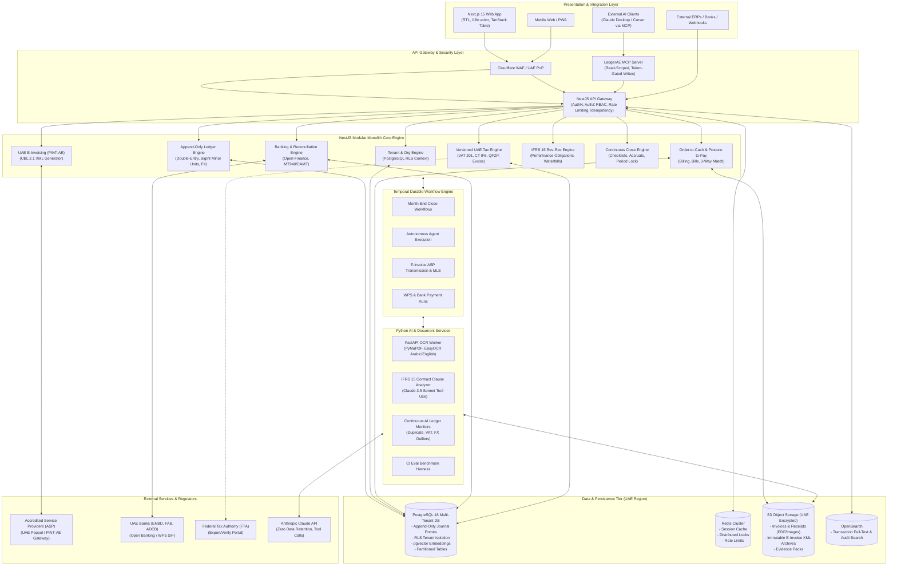
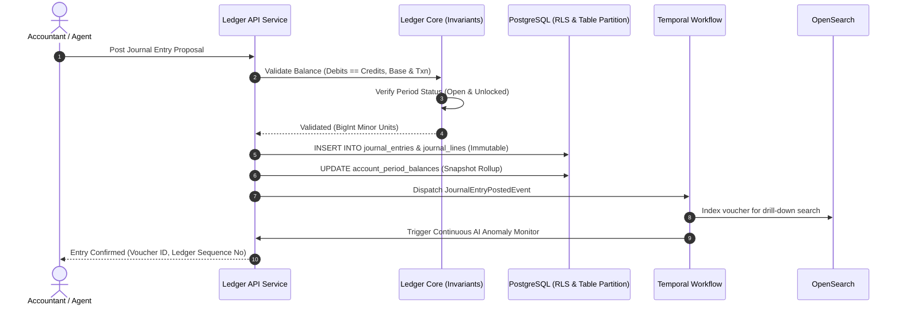
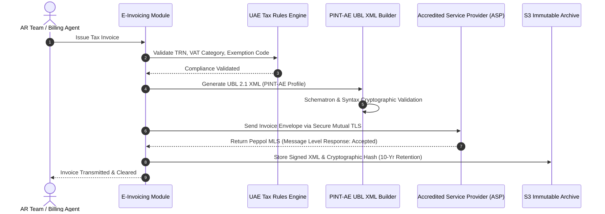

# LedgerAE: System Architecture Document



---

## 1. Monorepo Structure

```
ledger-ae/
├── apps/
│   ├── api/                    # NestJS Modular Monolith API
│   │   ├── src/
│   │   │   ├── auth/           # UAE PASS SSO, JWT, 2FA, RBAC
│   │   │   ├── tenants/        # Multi-tenant context & RLS interceptor
│   │   │   ├── ledger/         # Append-only journal & account services
│   │   │   ├── taxes/          # VAT, CT, QFZP endpoints & reports
│   │   │   ├── billing/        # Invoices, credit notes, payments
│   │   │   ├── bills/          # POs, GRNs, Vendor Bills, 3-way match
│   │   │   ├── banking/        # Statements, reconciliation engine
│   │   │   ├── close/          # Checklists, period locking, accruals
│   │   │   ├── einvoicing/     # PINT-AE generation & ASP client
│   │   │   └── temporal/       # Workflows & activities client
│   │   └── test/
│   ├── web/                    # Next.js 15 App Router (Tailwind, TanStack Table)
│   │   ├── src/
│   │   │   ├── app/            # App routes (en/ar with RTL support)
│   │   │   ├── components/     # UI primitives & financial widgets
│   │   │   ├── hooks/          # React query hooks
│   │   │   └── lib/            # i18n, formatting (AED, Hijri/Gregorian)
│   └── mcp-server/             # Model Context Protocol server for books
├── packages/
│   ├── ledger-core/            # Pure TypeScript ledger engine (BigInt, Invariants)
│   ├── uae-tax-engine/         # Versioned, data-driven VAT/CT/QFZP rules
│   ├── shared-types/           # Shared DTOs, schemas, enums
│   └── ubl-pinta-generator/    # OASIS UBL 2.1 PINT-AE XML generator
├── services/
│   └── ai-service/             # Python FastAPI service
│       ├── app/
│       │   ├── ocr/            # Arabic/English invoice extractor
│       │   ├── revrec_nlp/     # IFRS 15 contract parser
│       │   ├── monitors/       # Continuous AI anomaly scanners
│       │   └── evals/          # Automated golden dataset evals
│       ├── tests/
│       └── requirements.txt
├── docker/                     # Docker Compose and Dockerfiles
├── infra/                      # Terraform configs for UAE cloud deployment
└── docs/                       # Architecture, PRD, ADRs, Threat Model
```

---

## 2. Event Sourcing & Perpetual Double-Entry Model

All ledger postings are handled through an append-only event stream:



---

## 3. Data Flow for UAE Peppol E-Invoicing (PINT-AE)



---

## 4. Multi-Tenant Row Level Security (RLS) Strategy

Tenant context is set per database session/transaction:
```sql
-- Enforced via NestJS RLS Interceptor
SET LOCAL app.current_tenant_id = 'ten_uae_12345';
SET LOCAL app.current_user_id = 'usr_cfo_98765';
SET LOCAL app.current_entity_id = 'ent_dubai_001';
```

Every database table contains `tenant_id`, and all Postgres policies enforce:
```sql
CREATE POLICY tenant_isolation_policy ON journal_lines
    FOR ALL
    USING (tenant_id = current_setting('app.current_tenant_id')::uuid);
```
