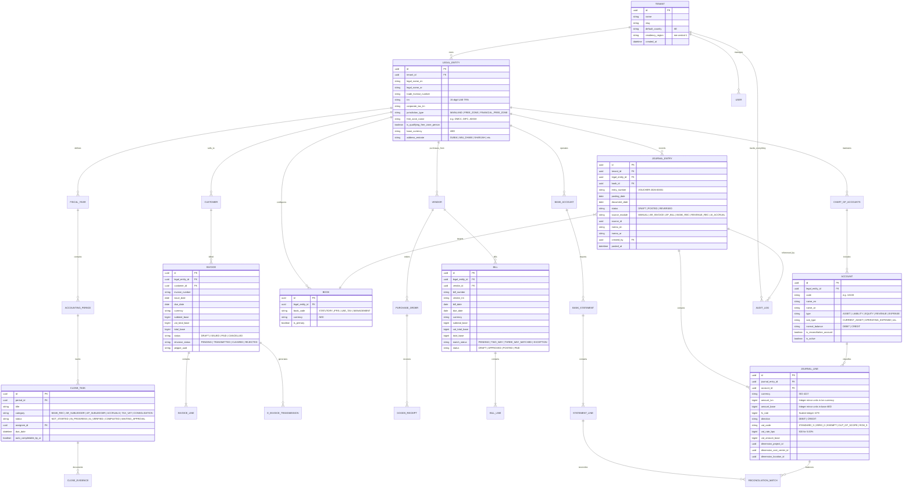

# LedgerAE: Core Domain Model & Entity Relationships



---

## 1. Monetary Unit and Arithmetic Domain Rule

```typescript
export interface Money {
  /** Amount in minor units, e.g. 100.50 AED is stored as 10050n */
  amount: bigint;
  /** ISO-4217 Currency Code, e.g. 'AED', 'USD' */
  currency: string;
  /** Currency scale factor / decimals, AED = 2, JPY = 0, KWD = 3 */
  decimals: number;
}

export interface FxRate {
  baseCurrency: string;     // 'AED'
  quoteCurrency: string;    // 'USD'
  /** Scaled integer: e.g. 3.67250000 stored as 367250000n with scale 10^8 */
  rate: bigint;
  rateScale: bigint;        // 100000000n
}
```

## 2. UAE VAT Code Tax Classification Model

```typescript
export enum UaeVatTaxCode {
  STANDARD_RATED_5 = 'SR_5',       // 5% standard rated supply
  ZERO_RATED_EXPORTS_0 = 'ZR_EXP_0', // 0% exported goods/services outside GCC
  ZERO_RATED_LOCAL_0 = 'ZR_LOC_0',   // 0% local qualifying (healthcare, education, local transport)
  EXEMPT_FINANCIAL = 'EX_FIN',      // Exempt financial services (margin-based)
  EXEMPT_RESIDENTIAL = 'EX_RES',    // Exempt residential real estate leases
  OUT_OF_SCOPE = 'OOS',             // Outside territorial scope of UAE VAT
  REVERSE_CHARGE_5 = 'RCM_5',       // Art. 48 reverse charge mechanism on imported goods/services
  DESIGNATED_ZONE_GOODS = 'DZ_GOODS'// Transfers within/between designated free zones
}
```

## 3. UAE Corporate Tax (CT) Model

```typescript
export interface CorporateTaxAssessment {
  entityId: string;
  taxPeriodYear: number;
  netAccountingProfitLoss: bigint;
  exemptions: {
    dividendsReceived: bigint;
    qualifyingParticipationExemption: bigint;
  };
  disallowableExpenses: {
    entertainment50PercentDisallowed: bigint; // 50% non-deductible
    finesAndPenalties: bigint;                // 100% non-deductible
    nonBusinessExpenses: bigint;
  };
  qualifyingFreeZoneStatus: {
    isQFZP: boolean;
    qualifyingRevenue: bigint;
    nonQualifyingRevenue: bigint;
    deMinimisRatioBps: bigint; // Must be <= 500 (5.00%) or AED 5M
    qualifyingIncomeTaxRate: 0; // 0%
    nonQualifyingTaxRate: 900;  // 9%
  };
  taxLossReliefBfwd: bigint; // Capped at 75% of taxable income
  taxableIncome: bigint;
  calculatedTaxDue: bigint;
  verifyWithTaxAdvisor: true; // Hard mandatory safeguard
}
```
